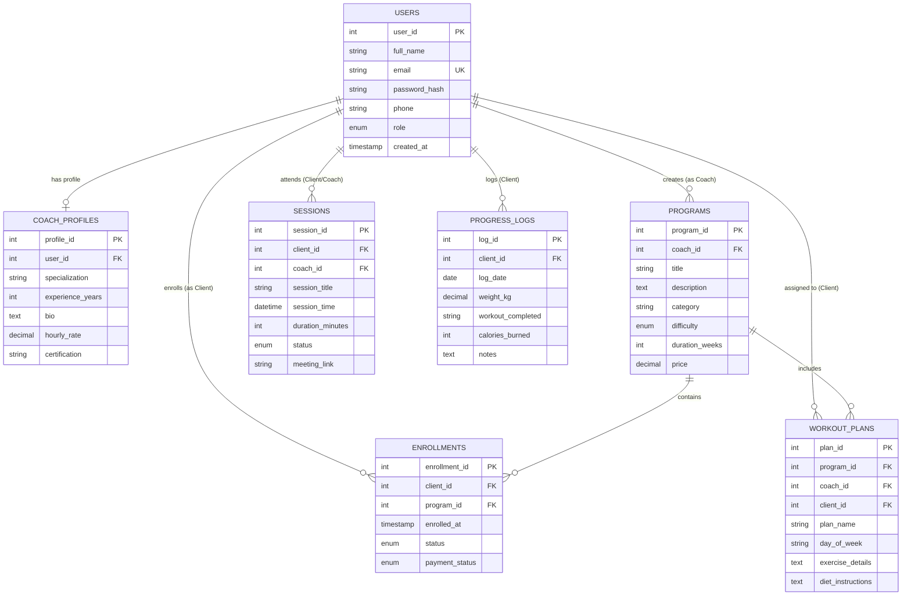

# FitCoach - Online Fitness Coaching Platform (Review 1)

FitCoach is a modern, modular Java web application developed for **GUVI x HCL Review 1**. It connects certified fitness trainers with clients looking to achieve body transformation goals through structured workout programs, 1-on-1 scheduled sessions, and daily progress analytics.

---

## 🛠️ Tech Stack (Strictly Compliant)
- **Language & Runtime:** Java 17 (LTS)
- **Build System:** Apache Maven
- **Web Layer:** Jakarta Servlet 6.0, JSP, JSTL 3.0 running on **Apache Tomcat 10.1**
- **Database:** MySQL 8.x using **Pure JDBC (PreparedStatement only, No ORM)**
- **Architecture:** MVC (Model-View-Controller) + DAO Pattern + Service Layer
- **Frontend:** Responsive HTML5, Modern Dark Theme CSS3 (Flexbox & CSS Grid), Vanilla JavaScript

---

## 👥 User Roles & Capabilities
1. **Client:** Registers, browses programs by category & search, enrolls in programs, views assigned daily workout routines, and logs physical progress (weight, calories, workouts).
2. **Coach:** Creates workout programs with custom pricing/difficulty, tracks client consults, and views assigned regimens.
3. **Admin:** System supervisor; manages all coaches, clients, and platform programs, and oversees platform statistics.

---

## 🏛️ Project Directory Structure
```
online fitness coaching platform/
├── pom.xml                               # Maven project dependencies & build configuration
├── schema.sql                            # Complete MySQL database schema & sample seed data
├── .gitignore                            # Git exclusion rules
├── README.md                             # Comprehensive project documentation
└── src/
    ├── main/
    │   ├── java/com/fitcoach/
    │   │   ├── dao/                      # Data Access Layer
    │   │   │   ├── GenericDAO.java       # Generic CRUD interface (Generics & Collections)
    │   │   │   ├── UserDAO.java          # User DAO interface
    │   │   │   ├── ProgramDAO.java       # Program DAO interface
    │   │   │   └── impl/
    │   │   │       ├── UserDAOImpl.java          # JDBC PreparedStatement implementation
    │   │   │       ├── ProgramDAOImpl.java       # JDBC PreparedStatement implementation
    │   │   │       └── CoachingActivityDAO.java  # Enrollments, Bookings & Logs
    │   │   ├── exception/                # Custom Exception Hierarchy
    │   │   │   ├── FitCoachException.java
    │   │   │   ├── DatabaseException.java
    │   │   │   ├── DuplicateEmailException.java
    │   │   │   ├── UserNotFoundException.java
    │   │   │   └── AuthenticationException.java
    │   │   ├── filter/
    │   │   │   └── AuthFilter.java       # Role-based HTTP session filter
    │   │   ├── model/                    # Domain POJOs (OOP Inheritance & Abstraction)
    │   │   │   ├── User.java             # Abstract base class
    │   │   │   ├── Client.java           # Concrete User subclass
    │   │   │   ├── Coach.java            # Concrete User subclass
    │   │   │   ├── Admin.java            # Concrete User subclass
    │   │   │   ├── Program.java
    │   │   │   ├── Enrollment.java
    │   │   │   ├── SessionBooking.java
    │   │   │   ├── WorkoutPlan.java
    │   │   │   ├── ProgressLog.java
    │   │   │   └── Role.java             # Enum
    │   │   ├── service/                  # Business Logic Layer
    │   │   │   ├── UserService.java      # Auth & registration logic
    │   │   │   └── ProgramService.java   # Program rules & searching
    │   │   ├── servlet/                  # Web Controllers (Jakarta Servlet 6)
    │   │   │   ├── AppContextListener.java     # Thread lifecycle listener
    │   │   │   ├── HomeServlet.java            # Public landing
    │   │   │   ├── LoginServlet.java           # Auth & role redirect
    │   │   │   ├── RegisterServlet.java        # User creation
    │   │   │   ├── LogoutServlet.java          # Session invalidation
    │   │   │   ├── ProgramServlet.java         # Program catalog & enrollment
    │   │   │   ├── ClientDashboardServlet.java # Client portal & progress logging
    │   │   │   ├── CoachDashboardServlet.java  # Coach program management
    │   │   │   └── AdminDashboardServlet.java  # Admin supervision
    │   │   └── util/                     # Utilities & Concurrency
    │   │       ├── DBConnection.java           # JDBC Connection pool from db.properties
    │   │       ├── PasswordUtil.java           # SHA-256 cryptographic password hashing
    │   │       ├── Validator.java              # Server-side validation
    │   │       └── SessionReminderService.java # Multithreading ScheduledExecutorService
    │   ├── resources/
    │   │   ├── db.properties             # Active database credentials
    │   │   └── db.properties.example     # Database credentials template
    │   └── webapp/
    │       ├── css/
    │       │   └── style.css             # Modern dark fitness theme & responsive CSS
    │       ├── js/
    │       │   └── main.js               # Client validation & mobile toggle
    │       └── WEB-INF/
    │           ├── web.xml               # Deployment descriptor (Servlet 6.0)
    │           └── views/
    │               ├── index.jsp         # Public Home
    │               ├── login.jsp         # Login View
    │               ├── register.jsp      # Register View
    │               ├── programs.jsp      # Programs Catalog View
    │               ├── client-dashboard.jsp # Client Dashboard View
    │               ├── coach-dashboard.jsp  # Coach Dashboard View
    │               ├── admin-dashboard.jsp  # Admin Dashboard View
    │               └── components/
    │                   ├── navbar.jsp
    │                   └── footer.jsp
    └── test/java/com/fitcoach/util/
        └── PasswordAndValidationTest.java # JUnit 5 test suite
```

---

## 💡 Core Java Concepts Demonstrated (Evaluation Highlights)
- **OOP Inheritance:** `User` abstract class is extended by `Client`, `Coach`, and `Admin`.
- **OOP Abstraction & Encapsulation:** Private attributes with getters/setters; abstract method `getDashboardUrl()` in `User`.
- **Polymorphism:** Calling `user.getDashboardUrl()` in servlets dynamically executes role-specific routing depending on runtime type.
- **Interfaces & Generics:** `GenericDAO<T>` provides generic CRUD contract implemented by concrete DAOs.
- **Collections Framework:** `List<T>`, `Optional<T>`, and `Map` used across service and DAO layers.
- **Custom Exceptions:** `FitCoachException` hierarchy (`DuplicateEmailException`, `UserNotFoundException`, `DatabaseException`, `AuthenticationException`).
- **Multithreading:** `SessionReminderService` utilizes a `ScheduledExecutorService` daemon thread to check upcoming coaching reminders every 60s in the background.
- **Security:** Passwords hashed with SHA-256 Hex before database persistence; `PreparedStatement` prevents SQL injection.

---

## 📊 Database Entity Relationship (ER Diagram)



---

## 🚀 Setup & Execution Guide for Beginners (macOS)

### 1. Prerequisites Installation (Using Homebrew)
If you don't have Homebrew installed on macOS, open Terminal and run:
```bash
/bin/bash -c "$(curl -fsSL https://raw.githubusercontent.com/Homebrew/install/HEAD/install.sh)"
```

Install Java 17, Maven, MySQL, and Tomcat:
```bash
# Install OpenJDK 17
brew install openjdk@17
sudo ln -sfn /opt/homebrew/opt/openjdk@17/libexec/openjdk.jdk /Library/Java/JavaVirtualMachines/openjdk-17.jdk

# Install Apache Maven
brew install maven

# Install MySQL Server
brew install mysql
brew services start mysql

# Install Apache Tomcat 10.1 (Jakarta EE 10 compliant)
brew install tomcat@10
```

Verify your installations:
```bash
java -version    # Must show OpenJDK 17
mvn -version     # Must show Apache Maven 3.8+
mysql --version  # Must show MySQL 8.x
catalina version # Must show Apache Tomcat 10.1
```

### 2. Database Initialization
In Terminal, import the provided schema and sample seed data:
```bash
mysql -u root -p < schema.sql
```
*(If your local root MySQL has no password, you can run: `mysql -u root < schema.sql`)*

Verify database creation:
```bash
mysql -u root -p -e "USE fitcoach_db; SHOW TABLES;"
```

### 3. Configure Database Credentials
Open `src/main/resources/db.properties` and verify your credentials:
```properties
db.driver=com.mysql.cj.jdbc.Driver
db.url=jdbc:mysql://localhost:3306/fitcoach_db?useSSL=false&allowPublicKeyRetrieval=true&serverTimezone=UTC
db.user=root
db.password=YOUR_MYSQL_PASSWORD
```

### 4. Build the WAR Package
Navigate to the project root directory and build:
```bash
cd "online fitness coaching platform"
mvn clean package
```
This runs JUnit tests and generates the deployment archive `target/fitcoach.war`.

### 5. Deploy to Apache Tomcat 10.1
Copy the generated WAR file into Tomcat's `webapps` folder:
```bash
# For Homebrew on Apple Silicon:
cp target/fitcoach.war /opt/homebrew/opt/tomcat@10/libexec/webapps/

# For Intel Mac:
# cp target/fitcoach.war /usr/local/opt/tomcat@10/libexec/webapps/

# Start Tomcat server
brew services restart tomcat@10
```

Open your browser and visit:
👉 **`http://localhost:8080/fitcoach`**

---

## 🔑 Pre-seeded Test Accounts (Review 1)
All pre-seeded demo accounts share the password: **`Password@123`**

| Role | Email | Password | Target Dashboard |
|---|---|---|---|
| **Admin** | `admin@fitcoach.com` | `Password@123` | `/fitcoach/admin/dashboard` |
| **Coach** | `coach.marcus@fitcoach.com` | `Password@123` | `/fitcoach/coach/dashboard` |
| **Coach** | `coach.elena@fitcoach.com` | `Password@123` | `/fitcoach/coach/dashboard` |
| **Client** | `rahul@client.com` | `Password@123` | `/fitcoach/client/dashboard` |
| **Client** | `priya@client.com` | `Password@123` | `/fitcoach/client/dashboard` |

---

## 📸 Screenshots Section (Placeholders for Submission Document)
- **Landing Page:** Modern hero section, program previews, dynamic navigation bar.
- **Login & Register:** Responsive forms with live client & server-side validation error banners.
- **Client Dashboard:** Metrics, enrolled program cards, workout routine cards, progress log history.
- **Coach Dashboard:** Form to publish new workout regimens and list of assigned consultations.
- **Admin Dashboard:** Platform user management table with role badges and deletion actions.

---

## 📤 Push to GitHub (Step-by-Step)
In Terminal:
```bash
cd "online fitness coaching platform"
git init
git add .
git commit -m "FitCoach Platform - GUVI x HCL Review 1 complete submission"
git branch -M main
git remote add origin https://github.com/<YOUR_GITHUB_USERNAME>/<YOUR_REPOSITORY_NAME>.git
git push -u origin main
```
